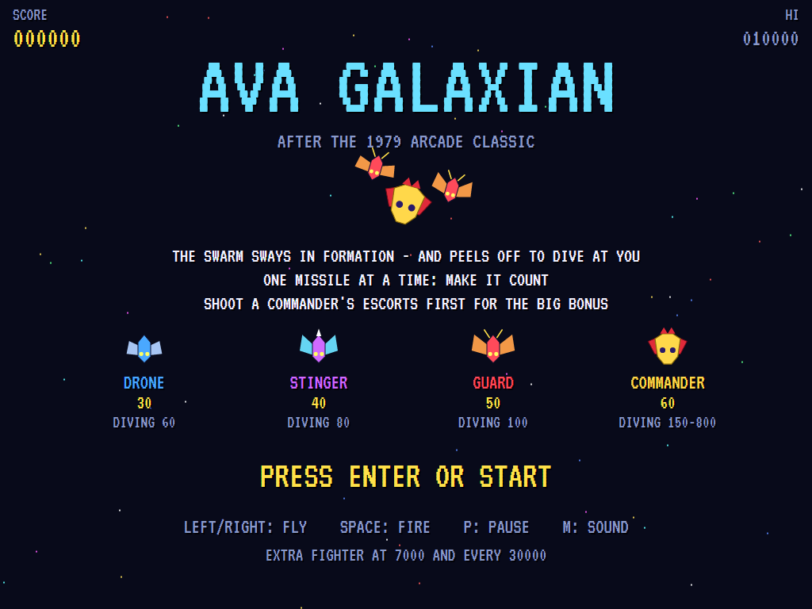
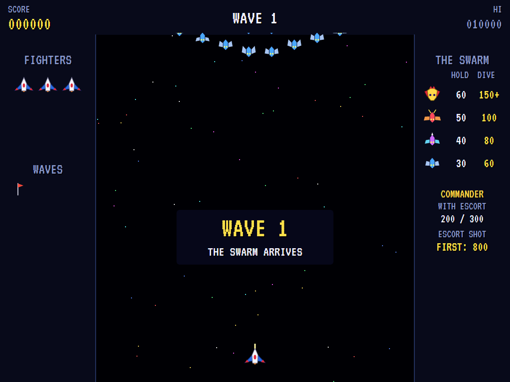
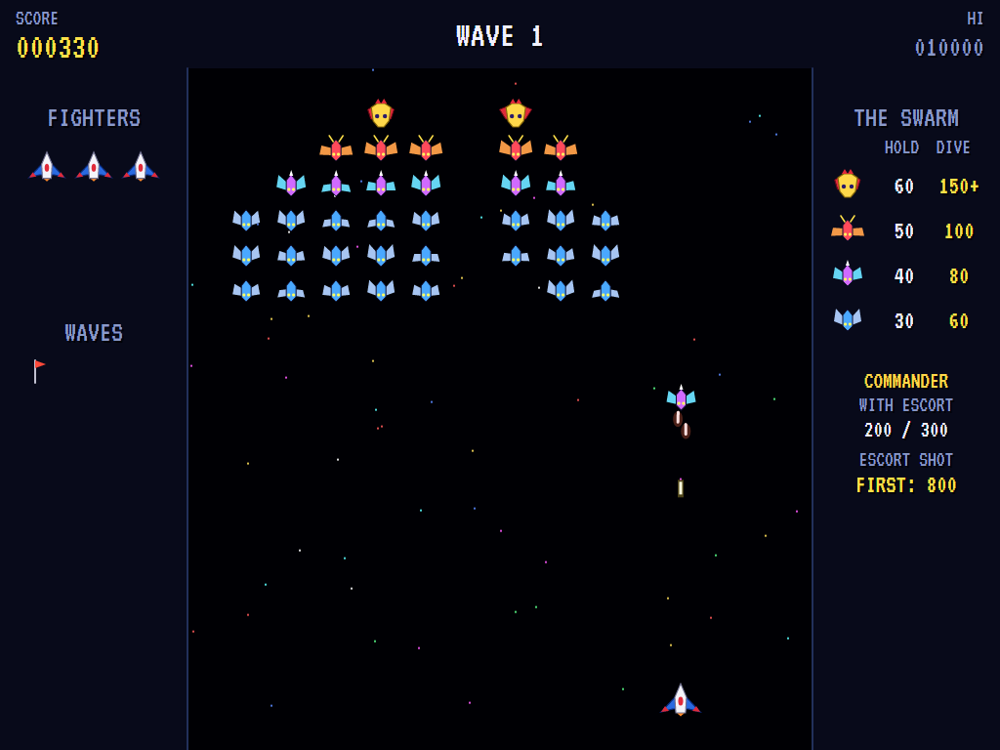
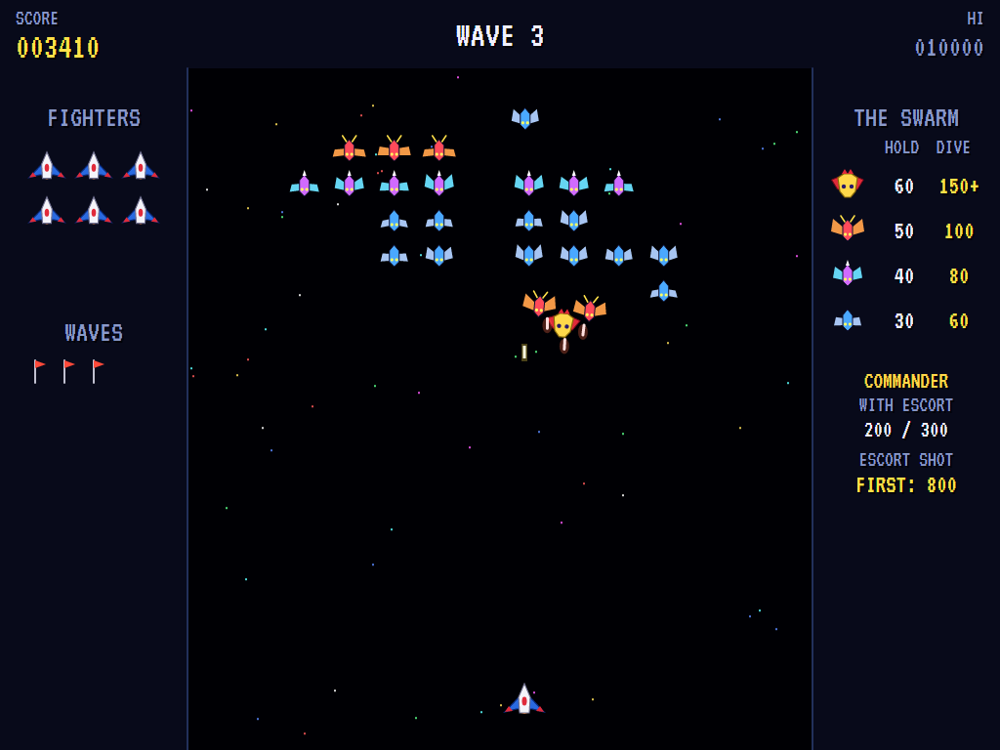
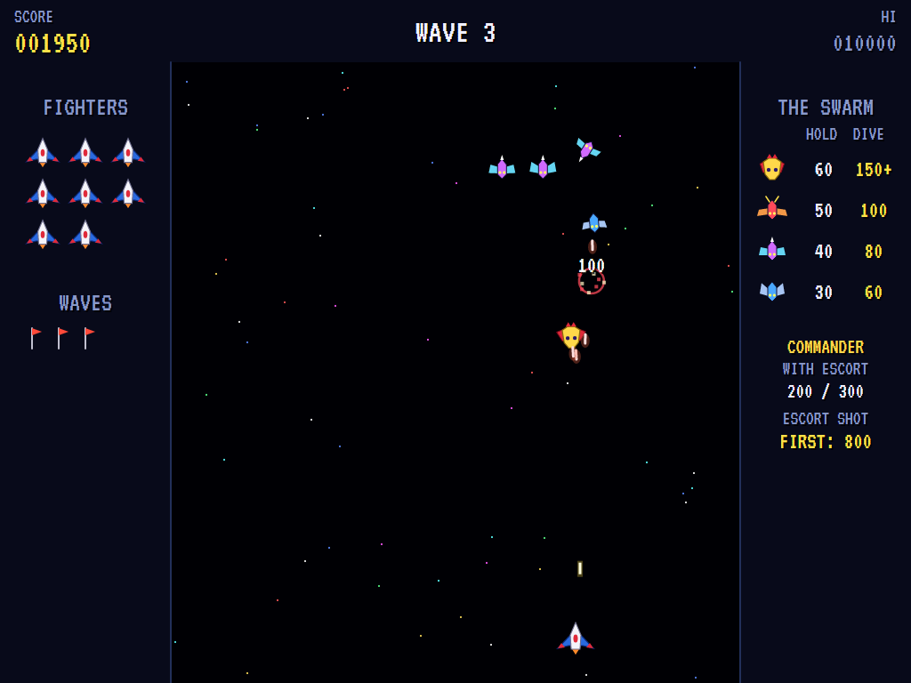
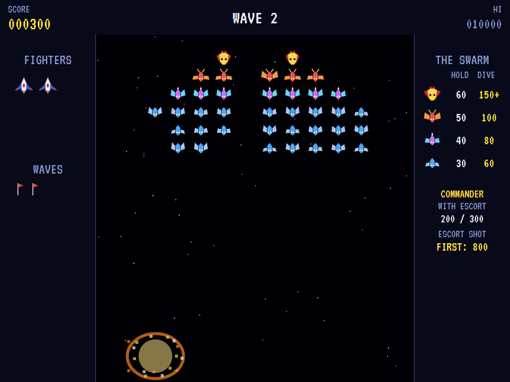
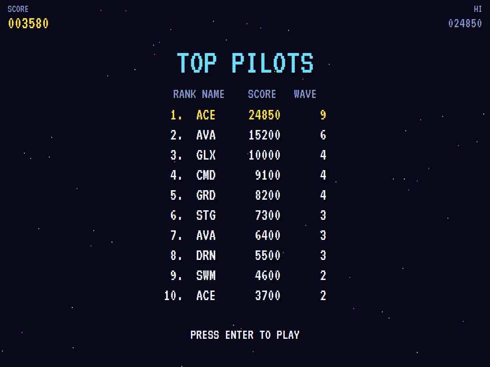

# AVA Galaxian

[](https://github.com/Harlock123/AVAGalaxian/actions/workflows/build.yml)

A swarm shooter in the style of the 1979 arcade game **Galaxian**, built with .NET 10 and Avalonia UI.
A swarm of 46 aliens sways in formation at the top of the screen. One by one they peel off and dive at
your fighter, firing as they come. The commanders bring guards along as escorts. You have one missile in
the air at a time, so make it count.

## Features

- **Your fighter**:
  - **Flying:** it slides left and right along the bottom.
  - **Firing:** it fires one missile at a time, and each shot takes a fresh press of the button. While a missile is loaded, you can see it sitting on the fighter's nose.
- **The swarm**:
  - **The formation:** two **Commanders** at the top, then a row of six **Guards**, a row of eight **Stingers** and three rows of ten **Drones**. The whole formation sways from side to side, wings beating.
  - **Diving:** every so often an alien from the end of a row peels off. It loops up and out, then sweeps down at your fighter in an arc, firing on the way.
    - Anything that flies past the bottom comes round again from the top and goes back to its place.
  - **Commanders:** a commander dives with up to two guards from beside it. They fly in a V on either side of it, a little behind.
    - If the commander is shot, its escorts carry on alone.
  - **The last few:** once only six are left, they stop going home and come at you without a break.
  - **Later waves** dive more often, with more aliens in the air at once, and they fly and fire faster.
- **Scoring**:

  | | In formation | Diving |
  |---|---:|---:|
  | Drone | 30 | 60 |
  | Stinger | 40 | 80 |
  | Guard | 50 | 100 |
  | Commander | 60 | 150 alone |

  - **A diving commander with escorts** is worth 200 with both escorts still flying and 300 with one. If you shoot both escorts first, it is worth **800** (400 if it only had one).
  - **Extra fighters** come at 7,000 and every 30,000 after that.
- **Sound**:
  - **The title tune:** an original space fanfare in G.
  - **The effects:** the missile's zip, the aliens' blips, the falling whistle of a dive, the escort's call, pops and bursts, the bonus run, and the swarm's low hum, plus jingles.
  - All of it is synthesised and mixed by OpenAL.
- **Attract mode**: leave the title alone for 15 seconds and a computer pilot plays.
  - It looks a moment ahead for bullets and divers and slips aside from them.
  - Otherwise it lines up under the best target, leading it so the missile meets it. Divers come first, escorts before their commander, then the lowest and nearest of the formation.
- **A top-ten high-score table** with arcade-style initials entry. It records the wave reached.
- **Gamepads** through SDL2, as well as the keyboard.
- **Any window size**: the screen scales to fit, letterboxed. **Ctrl+S** saves a screenshot.
- **One self-contained executable** per platform: Windows, macOS and Linux on Intel/AMD and ARM.

## Screenshots

| The title | The swarm flies in | Under attack |
|:---------:|:------------------:|:------------:|
|  |  |  |
| What everything is worth. | Each wave arrives from above. | Divers firing on the way down. |

| A commander's escort | The last few | Shot down |
|:--------------------:|:------------:|:---------:|
|  |  |  |
| Two guards in a V. | No more going home. | One bullet too many. |

| Top pilots | | |
|:----------:|:-:|:-:|
|  | | |
| The high-score table. | | |

The screenshots are made by the tests, which play the game in a real (headless) window; see
[Tests](#tests).

## Download and run

Ready-to-run builds for Windows, macOS and Linux, on both Intel/AMD and ARM, are on the
[Releases page](https://github.com/Harlock123/AVAGalaxian/releases/tag/latest). **Latest build** is
rebuilt on every push to `main`. Each download is one self-contained executable: no .NET install is
needed.

| Platform | Archive |
|---|---|
| Windows | `AVAGalaxian-win-x64.zip`, `AVAGalaxian-win-x86.zip`, `AVAGalaxian-win-arm64.zip` |
| macOS | `AVAGalaxian-osx-arm64.tar.gz` (Apple silicon), `AVAGalaxian-osx-x64.tar.gz` (Intel) |
| Linux | `AVAGalaxian-linux-x64.tar.gz`, `AVAGalaxian-linux-arm64.tar.gz`, `AVAGalaxian-linux-arm.tar.gz` |

```bash
tar -xzf AVAGalaxian-linux-x64.tar.gz     # or linux-arm64, linux-arm, osx-arm64, osx-x64
./AVAGalaxian
```

On Windows, unzip and run `AVAGalaxian.exe`. On macOS, if Gatekeeper refuses to open it, run
`xattr -d com.apple.quarantine AVAGalaxian` once. Run with `--no-audio` for silence.

**Sound** comes through OpenAL Soft, built in for every platform. In a virtual machine the game
detects it and uses a larger audio buffer, so the sound doesn't break up.

**Gamepads** use SDL2, which is bundled for Windows, macOS and Intel/AMD Linux. ARM Linux builds need it
installed; without it the keyboard still works:

```bash
sudo apt install libsdl2-dev            # Debian / Ubuntu / Raspberry Pi OS
sudo pacman -S --needed sdl2-compat     # Arch / Omarchy
```

## Controls

| Input | Action |
|-------|--------|
| **Enter** | Start |
| **Left** / **Right** (or **A** / **D**, or the numeric keypad) | Fly |
| **Space** / **Z** / **X** / **Up** / **W** / **Ctrl** | Fire (a fresh press for each missile) |
| **P** / **Esc** | Pause (Esc again to quit) |
| **M** | Mute |
| **Ctrl+S** / **Cmd+S** | Save a screenshot to the Pictures folder |

**Gamepad**: left stick or D-pad to fly, **A**, **B** or **X** to fire, **Start** to start and pause,
**Back** (while paused) to quit.

**Entering initials**: type letters, or dial with **Up**/**Down** and accept with **Space**; **Left** /
**Backspace** go back; **Enter** finishes.

## Tests

```bash
dotnet test AVAGalaxian.slnx
```

The engine has no UI and runs in fixed 60 Hz steps, so it plays the same at any frame rate, and a seed
always plays the same game. The tests check:

- **The swarm:**
  - the formation's make-up and order
  - flying in from above to its places
  - swaying from side to side
- **The missile:** one in the air at a time, and a fresh press for each
- **Scoring:** each kind's points in formation and diving
- **Commanders and escorts:**
  - two guards from beside the commander, flying in a V
  - the 200 / 300 / 800 / 400 commander bonuses, played through
  - escorts carrying on alone when their commander falls
- **Dives:**
  - the loop out, the run down to the fighter, and round from the top back to its place
  - diving by themselves, firing on the way down
  - the last few attacking without a break
- **Losing fighters:**
  - to bullets, and to rammers (which go down too)
  - divers going home before the next fighter
  - the last fighter ending the game
- **The machine:** the next wave and its pace, extra fighters, the attract cycle, the computer pilot scoring, the same game from the same seed, and pausing

The screenshot tests draw the real screen in a headless window. To refresh the README's pictures:

```bash
GALAXIAN_SHOTS=$PWD/Images dotnet test tests/AVAGalaxian.Tests --filter ScreenshotTests
```

To see how the computer pilot gets on, wave by wave (for tuning), or how a player who just sits in the
middle and fires does (`GALAXIAN_PROBE=lazy`):

```bash
GALAXIAN_PROBE=1 dotnet test tests/AVAGalaxian.Tests --filter PilotProbe --logger "console;verbosity=detailed"
```

## Building

```bash
dotnet build AVAGalaxian.slnx
dotnet run --project src/AVAGalaxian
```

Needs the .NET 10 SDK. The sounds are made by `tools/make_sounds.py` (standard-library Python):
`python3 tools/make_sounds.py` rewrites `src/AVAGalaxian/Sounds`.

## Project structure

```
AVAGalaxian/
├── AVAGalaxian.slnx
├── src/AVAGalaxian/
│   ├── Engine/
│   │   ├── GameEngine.cs        # States, the title and demo cycle, and the swarm's hum
│   │   ├── GameEngine.Play.cs   # The fighter and its missile, the formation, dives and escorts,
│   │   │                        # bullets, the last few, and scoring
│   │   ├── ShipPilot.cs         # The computer pilot, for the demonstration (and the tests)
│   │   ├── Entities.cs          # The field, the fighter, missiles, bullets and aliens
│   │   ├── HighScoreTable.cs, InitialsEntry.cs
│   │   ├── InputHandler.cs, ControllerManager.cs  # Keys and an SDL2 gamepad
│   │   └── SoundManager.cs      # Effects and the tunes through OpenAL
│   ├── Audio/                   # The OpenAL engine (from the author's AVABand)
│   ├── Views/                   # The starfield, the fighter, the aliens, the panels, the screens
│   └── Sounds/                  # The synthesised effects and tunes
├── tests/AVAGalaxian.Tests/     # Gameplay, screenshot and probe tests
├── tools/make_sounds.py
└── Images/                      # Screenshots
```

## About and licence

AVA Galaxian © 2026 Lonnie Watson, under the [MIT License](LICENSE).

*Galaxian* © 1979 Namco; the name belongs to its current owner. AVA Galaxian is an independent,
unofficial game in its style. Its fighter, its Drones, Stingers, Guards and Commanders, its graphics,
sounds, tunes and code are its own; nothing is taken from the arcade machine's program, graphics, sound
or music. It is not affiliated with or endorsed by any rights holder.
